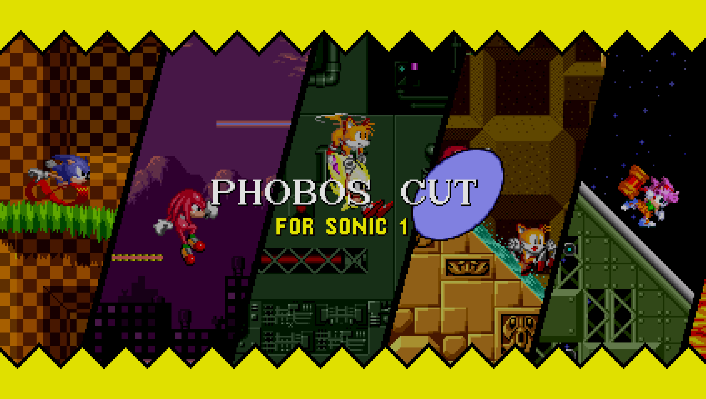

# Phobos-Cut-Public

  

    
  

Phobos Cut is a mod that aims to make tweaks to and improve Sonic the Hedgehog (2013) and its Sonic Origins counterpart in varying ways!

It sports a variety of new features, such as an all-new script-based main menu with new menus and options. There are also various bugfixes and parity additions between the other games, including QOL changes from Sonic Mania and 3K!

https://github.com/user-attachments/assets/a4d29a13-ade9-4a04-9be2-a87e78fde964

An example of a QOL feature that Phobos Cut offers, its Time Attack revamp 
